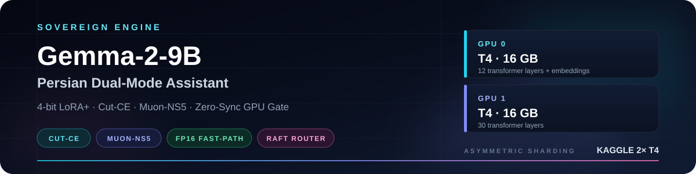
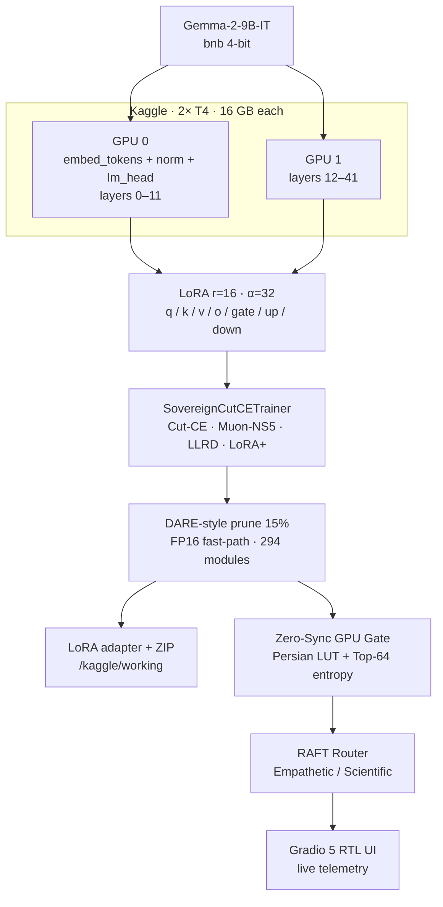

<div align="center">



<br>


</div>

---

<div dir="rtl" align="right">

# 👑 Sovereign Engine — چت‌بات دوحالتهٔ فارسی با Gemma-2-9B روی Kaggle 2×T4

**یک pipeline کامل و end-to-end در یک فایل: از QLoRA و Cut-CE تا گیت لوجیت فارسی، روتر RAFT دوحالته و رابط Gradio راست‌چین با تله‌متری زنده.**

این مخزن یک دموی کامل و قابل اجرا از fine-tuning و استقرار یک مدل زبانی فارسی روی سخت‌افزار محدود است. `app.py` را در یک Kaggle Notebook با دو GPU T4 اجرا می‌کنید؛ اسکریپت مدل را ۴ بیت بارگذاری می‌کند، یک LoRA کوتاه روی دادهٔ فارسی آموزش می‌دهد، آداپتور را ذخیره می‌کند و بلافاصله یک چت‌بات Gradio راست‌چین با حافظهٔ مکالمه و تله‌متری زنده بالا می‌آورد.

<br>

> ⚠️ **این یک دموی end-to-end است، نه یک مدل production.**
> مجموعهٔ آموزش فقط **۴ نمونهٔ دست‌نویس فارسی** است که **۸ بار تکرار** شده‌اند (۳۲ ردیف). هدف، نشان دادن مسیر کامل آموزش، بهینه‌سازی و استقرار روی ۲×T4 است؛ نه ساخت یک دستیار عمومی یا جایگزین مشاورهٔ پزشکی.

> 📊 **شفافیت دربارهٔ اعداد عملکرد:**
> در کامنت‌های `app.py` اعدادی مثل «۲.۸× سریع‌تر» یا «−۱.۵GB VRAM» به‌عنوان هدف طراحی ذکر شده‌اند. در این مخزن بنچمارک مستقل و قابل بازتولیدی برای آن‌ها منتشر نشده است؛ پس آن‌ها را نتیجهٔ اندازه‌گیری‌شده در نظر نگیرید.

</div>

---

<div dir="rtl" align="right">

## ⚡ خلاصه در یک نگاه

| مورد | مقدار |
|:--|:--|
| مدل پایه | `unsloth/gemma-2-9b-it-bnb-4bit` — Gemma-2-9B-IT، کوانتایز ۴ بیت |
| سخت‌افزار هدف | Kaggle `GPU T4 x2` — دو کارت ۱۶ گیگابایتی |
| توزیع مدل | GPU0: embedding/norm/lm_head + لایه‌های ۰–۱۱ · GPU1: لایه‌های ۱۲–۴۱ |
| روش آموزش | QLoRA + Cut-CE + Muon-NS5 + LLRD + LoRA+ |
| طول آموزش | ۲۲ استپ، یا توقف زودتر وقتی loss ≤ 0.50 |
| دقت | FP16 — T4 (sm_75) از BF16 پشتیبانی نمی‌کند |
| رابط کاربری | Gradio 5، RTL، فونت Vazirmatn/Tahoma |
| حالت‌ها | همدلی و کوچینگ (Empathetic) + علمی تخصصی (PhD RAFT) |
| خروجی | آداپتور LoRA + فایل ZIP در `/kaggle/working` |
| مجوز کد | MIT — وزن‌های Gemma تحت Gemma Terms of Use |

</div>

---

<div dir="rtl" align="right">

## 🎯 این پروژه چه کاری می‌کند؟

بیشتر نمونه‌های fine-tuning روی GPUهای گران‌قیمت و با دادهٔ حجیم اجرا می‌شوند. این پروژه برعکس عمل می‌کند: **با یک Kaggle Notebook و دو T4**، یک مدل ۹ میلیارد پارامتری را به‌صورت ۴ بیت بارگذاری می‌کند، یک آداپتور سبک آموزش می‌دهد و همان لحظه یک چت‌بات قابل استفاده می‌سازد.

### جریان اجرا

1. **بارگذاری ۴ بیتی** — مدل Gemma-2-9B-IT با `bitsandbytes` به‌صورت 4-bit روی دو کارت تقسیم می‌شود.
2. **آماده‌سازی داده** — ۴ نمونهٔ فارسی همدلی/کوچینگ با قالب chat template جمما توکنایز می‌شوند؛ توکن‌های prompt با `-100` ماسک می‌شوند تا فقط پاسخ مدل آموزش ببیند.
3. **آموزش LoRA** — یک آداپتور `r=16` روی ۷ ماژول هر ۴۲ لایه با `SovereignCutCETrainer` آموزش می‌بیند.
4. **جراحی پس از آموزش** — وزن‌های کم‌اهمیت هرس می‌شوند، آداپتور به FP16 می‌رود و یک مسیر سریع `FP16 Tensor-Core LoRA` روی ۲۹۴ ماژول تزریق می‌شود.
5. **ساخت گیت فارسی** — یک LUT درون‌VRAM برای پرانتزها و کاراکترهای مجاز ساخته می‌شود؛ خروجی مدل فارسی می‌ماند و اصطلاحات انگلیسی فقط داخل پرانتز مجازند.
6. **روتر دوحالته** — پیام کاربر بررسی می‌شود و بین حالت همدلی و حالت علمی RAFT یکی انتخاب می‌شود.
7. **استقرار** — رابط Gradio راست‌چین با حافظهٔ ۶ تبادل آخر، تله‌متری tok/s، TTFT و VRAM بالا می‌آید.

</div>

---

<div dir="rtl" align="right">

## 🏗️ معماری

</div>



<div dir="rtl" align="right">

### چرا توزیع نامتقارن ۱۲/۳۰؟

مدل ۴۲ لایه دارد. اگر لایه‌ها را ۲۱/۲۱ تقسیم کنیم، `embed_tokens`، `norm` نهایی و `lm_head` هم باید جایی قرار بگیرند. در این پیاده‌سازی، سرِ خروجی و embeddingها روی **GPU0** هستند؛ بنابراین GPU0 فقط **۱۲ لایه** و GPU1 **۳۰ لایه** را نگه می‌دارد تا حافظهٔ دو کارت متعادل بماند و هنگام محاسبهٔ لوجیت‌ها، `lm_head` روی همان کارتی باشد که خروجی نهایی را می‌سازد.

> این نقشهٔ دستی برای Gemma-2-9B با ۴۲ لایه تنظیم شده است. اگر مدل پایه را عوض کردید، `gemma_device_map` را هم بازبینی کنید.

</div>

---

<div dir="rtl" align="right">

## 🧠 تکنیک‌های کلیدی

### ۱. Cut-Cross-Entropy (Cut-CE)

در آموزش معمولی، لوجیت‌های کامل مدل با واژگان ۲۵۶٬۰۰۰ توکنی به‌صورت `[Batch, Seq, 256000]` در FP32 ساخته می‌شوند؛ روی T4 این تانسور به‌سرعت VRAM را می‌بلعد. در `SovereignCutCETrainer`:

- فقط توکن‌های **فعال** (برچسب‌های مخالف `-100`) انتخاب می‌شوند.
- لوجیت‌ها در بلوک‌های **۱۲۸ توکنی** محاسبه می‌شوند.
- `cross_entropy` هر بلوک با `reduction="sum"` جمع و در نهایت بر تعداد توکن‌های فعال تقسیم می‌شود.
- softcap جمما با یک کرنل JIT (`torch.jit.script`) روی هر بلوک اعمال می‌شود.

**نتیجهٔ طراحی:** حذف تانسور غول‌پیکر لوجیت‌ها و کاهش فشار حافظه. اعداد دقیق کاهش VRAM در این مخزن مستقل اندازه‌گیری نشده‌اند.

### ۲. Muon-NS5 — متعامدسازی گرادیان با نیوتن-شولتز

پس از هر `training_step`، گرادیان‌های دوبعدی LoRA با **۵ گام چندجمله‌ای نیوتن-شولتز** روی Tensor Cores متعامد می‌شوند:

```text
X ← 3.4445·X − 4.7750·(X·Xᵀ)·X + 2.0315·(X·Xᵀ)²·X
```

سپس گرادیان نهایی به‌صورت ترکیبی استفاده می‌شود:

```text
g_final = 0.72 · g + 0.28 · g_ortho · (‖g‖ / ‖g_ortho‖)
```

این کار فقط روی پارامترهای دوبعدی LoRA اعمال می‌شود؛ نه روی کل مدل. هدف، بهبود conditioning به‌روزرسانی‌ها و پایدارتر کردن آموزش کوتاه است.

### ۳. LoRA+ و Layer-wise LR Decay

| پارامتر | مقدار |
|:--|:--|
| `r` | ۱۶ |
| `lora_alpha` | ۳۲ |
| `lora_dropout` | ۰٫۰۵ |
| ماژول‌ها | `q_proj`, `k_proj`, `v_proj`, `o_proj`, `gate_proj`, `up_proj`, `down_proj` |
| نرخ یادگیری پایه | `8.5e-5` |
| ضریب LR ماتریس B | `2.0` |
| Layer decay | `0.96^(41 − layer_index)` |
| بهینه‌ساز | `PagedAdamW8bit` |
| Weight decay | `0.01` |

لایه‌های بالاتر (نزدیک خروجی) LR بزرگ‌تری می‌گیرند و لایه‌های پایین‌تر LR کوچک‌تری؛ ماتریس `lora_B` هم با ضریب ۲ سریع‌تر حرکت می‌کند. این ترکیب برای آموزش کوتاه ۲۲ استپی طراحی شده است.

### تنظیمات آموزش

| پارامتر | مقدار |
|:--|:--|
| `max_length` | ۵۱۲ توکن |
| `per_device_train_batch_size` | ۱ |
| `gradient_accumulation_steps` | ۲ |
| `max_steps` | ۲۲ |
| `warmup_steps` | ۲ |
| `fp16` | `True` |
| `save_strategy` | `no` |
| `report_to` | `none` |
| توقف زودتر | `loss ≤ 0.50` |

طول مؤثر batch برابر ۲ است (۱ × ۲ accumulation). چون `save_strategy="no"` است، در طول آموزش هیچ چک‌پوینتی روی دیسک نوشته نمی‌شود و فقط آداپتور نهایی ذخیره می‌شود.

### ۴. مسیر سریع FP16 Tensor-Core LoRA

پس از آموزش، وزن‌های LoRA به FP16 خالص تبدیل می‌شوند و یک `forward` سفارشی روی **۲۹۴ ماژول** (۴۲ لایه × ۷ ماژول) تزریق می‌شود:

```python
delta = (x_fp16 @ Aᵀ) @ Bᵀ
out = base_layer(x) + delta.to(base_out.dtype) * scaling
```

ماتریس‌های `A` و `B` از قبل transpose و contiguous شده‌اند تا در هر توکن، تبدیل dtype و حلقه‌های پایتونی PEFT حذف شوند. این بخش برای T4 که Tensor Coreهای FP16 دارد طراحی شده است.

### ۵. هرس DARE-style

پس از آموزش:

- ۱۵٪ وزن‌های LoRA با کمترین قدر مطلق هرس می‌شوند.
- وزن‌های باقی‌مانده بر `0.85` تقسیم می‌شوند تا مقیاس تقریباً حفظ شود.
- آداپتور به FP16 تبدیل و ذخیره می‌شود.

> این پیاده‌سازی **DARE-style** است (هرس + rescale) و نسخهٔ کامل الگوریتم DARE-TIES با رأی‌گیری علامت‌ها نیست.

### ۶. گیت Zero-Sync فارسی

گیت لوجیت‌ها بدون هیچ `tolist()` یا `decode()` در حین تولید کار می‌کند:

- یک **LUT** روی GPU مشخص می‌کند توکن پرانتز باز است یا بسته.
- کاراکترهای غیرفارسی/غیرعربی خارج از پرانتز مسدود می‌شوند.
- حروف لاتین فقط وقتی مجازند که داخل پرانتز باز باشیم.
- آنتروپی شانون روی **Top-64** لوجیت محاسبه می‌شود؛ اگر از `1.7` بیشتر باشد، لوجیت‌ها با ضریب `1.35` تیزتر می‌شوند.

این کار باعث می‌شود متن اصلی فارسی بماند، اما اصطلاحاتی مثل `(Na+/K+-ATPase)` یا `(Grouped-Query Attention)` قابل نوشتن باشند.

### ۷. روتر RAFT دوحالته

روتر در این نسخه از بازیابی واژگانی سبک استفاده می‌کند، نه embedding یا BM25 سنگین:

- تطابق دقیق کلمات کلیدی + تطابق پیشوند ۴ کاراکتری ریشه‌ها.
- حذف ایست‌واژه‌های فارسی.
- تشخیص کلمات محرک علمی (`پتاسیم`، `انسولین`، `کوانتومی`، `رمزنگاری`، `توکن` و…).
- تشخیص سؤال پیگیری و ارث‌بری حالت از تبادل قبلی.
- حافظهٔ ۶ تبادل آخر.

اگر امتیاز علمی کافی باشد، حالت علمی فعال می‌شود؛ در غیر این صورت حالت همدلی. سؤال‌های کوتاه پیگیری، حالت قبلی را حفظ می‌کنند تا مکالمه وسط راه عوض نشود.

### ۸. Softcap JIT جمما

Gemma-2 روی لوجیت‌های نهایی softcap اعمال می‌کند. به‌جای چند رفت‌وبرگشت به حافظه، یک کرنل JIT کوچک:

```python
torch.tanh(scores / softcap) * softcap
```

این کرنل هم در مسیر آموزش (Cut-CE) و هم در تولید استفاده می‌شود.

</div>

---

<div dir="rtl" align="right">

## 🚀 شروع سریع در Kaggle (2×T4)

### پیش‌نیازها

- حساب Kaggle با تأیید شمارهٔ موبایل (برای GPU و Internet).
- حساب Hugging Face و پذیرش مجوز Gemma.
- یک توکن خواندنی Hugging Face.
- حدود چند گیگابایت فضای دیسک برای دانلود مدل و ذخیرهٔ آداپتور.

### گام ۱ — Notebook را روی 2×T4 تنظیم کنید

در Kaggle Notebook:

| تنظیم | مقدار |
|:--|:--|
| **Accelerator** | `GPU T4 x2` |
| **Internet** | `On` |

> بدون `GPU T4 x2` اسکریپت عمداً با یک خطای واضح متوقف می‌شود؛ این دمو برای دو کارت طراحی شده است.

### گام ۲ — مجوز Gemma و توکن Hugging Face

1. به صفحهٔ [google/gemma-2-9b-it](https://huggingface.co/google/gemma-2-9b-it) بروید و شرایط Gemma را بپذیرید.
2. صفحهٔ [unsloth/gemma-2-9b-it-bnb-4bit](https://huggingface.co/unsloth/gemma-2-9b-it-bnb-4bit) را باز کنید و اگر دسترسی gated خواست، آن را هم تأیید کنید.
3. از [Settings → Access Tokens](https://huggingface.co/settings/tokens) یک توکن با دسترسی **Read** بسازید.
4. در Kaggle: **Add-ons → Secrets → Add secret**؛ نام را `HF_TOKEN` و مقدار را توکن قرار دهید.

### گام ۳ — Clone و نصب وابستگی‌ها

در یک سلول Kaggle:

```python
!git clone https://github.com/IMI1998/Advanced-fine-tuning.git
%cd Advanced-fine-tuning
!pip install -q -r requirements.txt
```

> `requirements.txt` عمداً `torch` را نصب نمی‌کند؛ Kaggle از قبل یک PyTorch سازگار با CUDA دارد. اگر `pip` نسخهٔ `bitsandbytes` را ارتقا داد، یک بار **Restart Session** کنید و سلول‌ها را از ابتدا اجرا کنید.

### گام ۴ — ورود به Hugging Face

```python
import os
from kaggle_secrets import UserSecretsClient

os.environ["HF_TOKEN"] = UserSecretsClient().get_secret("HF_TOKEN")

from huggingface_hub import login
login(token=os.environ["HF_TOKEN"], add_to_git_credential=False)
```

برای اطمینان از دیده شدن دو کارت:

```python
import torch
print("CUDA devices:", torch.cuda.device_count())
print("GPU 0:", torch.cuda.get_device_name(0))
print("GPU 1:", torch.cuda.get_device_name(1))
```

باید عدد `2` و دو کارت `Tesla T4` ببینید.

### گام ۵ — اجرا

```python
!python app.py
```

اسکریپت مراحل را با `[1/7]` تا `[7/7]` چاپ می‌کند:

```text
🚀 [1/7] بارگذاری مدل روی ۲ کارت T4...
🔥 [2/7] شروع Fine-Tuning...
✂️ [3/7] هرس DARE-TIES + کامپایل کرنل FP16...
🛡️ [4/7] گیت Zero-Sync...
📡 [5/7] موتور بازیابی RAFT...
⚡ [6/7] تست سرعت کرنل...
🌐 [7/7] راه‌اندازی Gradio...
```

بعد از آموزش، یک **تست سرعت ۴۸ توکنی** اجرا می‌شود و `tok/s` و یک نمونه خروجی چاپ می‌کند. سپس لینک عمومی Gradio نمایش داده می‌شود:

```text
Running on public URL: https://xxxxxxxxxxxx.gradio.live
```

روی لینک کلیک کنید و گفتگو را شروع کنید.

### گام ۶ — دانلود خروجی

آداپتور و ZIP در پنل **Output** سمت راست Kaggle، زیر `/kaggle/working` قرار می‌گیرند. یا در یک سلول:

```python
from IPython.display import FileLink
FileLink("/kaggle/working/Gemma2_9B_Persian_GodMode_LoRA.zip")
```

</div>

---

<div dir="rtl" align="right">

## 💬 دو حالت گفتگو

| ویژگی | 💚 حالت همدلی | 🔬 حالت علمی |
|:--|:--|:--|
| فعال‌سازی | پیش‌فرض | امتیاز علمی ≥ ۲ یا کلمهٔ محرک + امتیاز ≥ ۱ |
| ضریب آداپتور | `1.35` | `0.70` |
| Temperature | `0.35` | `0.20` |
| Logits processor | `pure_persian_processor` | `gated_sci_processor_v2` |
| `max_new_tokens` | ۷۰۰ | ۷۰۰ |
| `min_p` | ۰٫۰۸ | ۰٫۰۸ |
| `repetition_penalty` | ۱٫۰۵ | ۱٫۰۵ |
| حافظه | ۶ تبادل آخر | ۶ تبادل آخر |

### نمونهٔ حالت همدلی

```text
خسته‌ام از تلاش بی‌نتیجه... هر چقدر می‌دوم به جایی نمی‌رسم، چیکار کنم؟
```

### نمونهٔ حالت علمی

```text
راستی یک سوال علمی: چرا در بیمار کتواسیدوز دیابتی تزریق فوری انسولین
بدون پتاسیم باعث ایست قلبی می‌شود؟
```

### نمونهٔ سؤال پیگیری

```text
مورد دوم که گفتی رو می‌شه با یک مثال عملی بیشتر برام باز کنی؟
```

در این حالت، روتر تشخیص می‌دهد سؤال پیگیری است و اگر تبادل قبلی علمی بوده، مرجع علمی را حفظ می‌کند.

</div>

---

<div dir="rtl" align="right">

## 📚 پایگاه دانش RAFT

پایگاه دانش این دمو فقط سه سند دست‌نویس دارد و برای نشان دادن مکانیزم grounding طراحی شده است:

| شناسه | حوزه | موضوع |
|:--|:--|:--|
| `med_dka_01` | پزشکی اورژانس | کتواسیدوز دیابتی، شیفت ترانس‌سلولار K⁺، پمپ Na⁺/K⁺-ATPase و خطر هیپوکالمی پس از انسولین |
| `quantum_crypto_02` | رمزنگاری پساکوانتومی | الگوریتم شور، QFT، LWE و مقاومت رمزنگاری شبکه‌ای در برابر کوانتوم |
| `gpu_arch_03` | معماری GPU | GQA، KV-Cache، شدت محاسباتی و گلوگاه پهنای باند حافظه |

برای افزودن سند جدید، یک دیکشنری با کلیدهای `id`، `domain` و `facts` به `enterprise_knowledge_base` اضافه کنید. روتر به‌صورت خودکار آن را در تطابق واژگانی شرکت می‌دهد.

> این محتوا آموزشی است و جایگزین منابع پزشکی یا مشاورهٔ تخصصی نیست.

</div>

---

<div dir="rtl" align="right">

## 🖥️ رابط کاربری و تله‌متری

رابط Gradio 5 به‌صورت کامل RTL است و از فونت‌های **Vazirmatn** و **Tahoma** استفاده می‌کند. در هر پاسخ، یک HUD زنده نمایش داده می‌شود:

- **حالت فعال** و مرجع علمی (در حالت RAFT)
- **سرعت لحظه‌ای** بر حسب `tok/s`
- **واژه بر دقیقه** (`WPM`)
- **TTFT** — زمان تا اولین توکن
- **تعداد تبادل‌های حافظه**
- **VRAM هر دو کارت** — `GPU0` و `GPU1`

همچنین:

- دکمهٔ **پاک کردن حافظه** برای شروع گفتگوی تازه
- مثال‌های آماده برای تست همدلی، پیگیری و حالت علمی
- استریم توکن‌به‌توکن با `TextIteratorStreamer`

> حافظه در `gr.State` نگه داشته می‌شود؛ با رفرش صفحه یا بستن تب پاک می‌شود.

</div>

---

<div dir="rtl" align="right">

## 📦 خروجی‌ها

روی Kaggle:

```text
/kaggle/working/
├── gemma2_9b_persian_godmode_lora/
│   ├── adapter_config.json
│   ├── adapter_model.safetensors   # یا adapter_model.bin بسته به نسخهٔ PEFT
│   └── tokenizer files
└── Gemma2_9B_Persian_GodMode_LoRA.zip
```

- پوشهٔ آداپتور برای بارگذاری مجدد با `PeftModel.from_pretrained` مناسب است.
- فایل ZIP همان پوشه را برای دانلود سریع بسته‌بندی می‌کند.
- پوشهٔ `gemma_master_pipeline/` خروجی `Trainer` است؛ چون `save_strategy="no"` است، هیچ چک‌پوینتی ذخیره نمی‌شود.

### تغییر مسیر خروجی

```python
import os
os.environ["SOVEREIGN_OUTPUT_DIR"] = "/kaggle/working/my_run"
```

اگر `/kaggle/working` وجود نداشته باشد (اجرای محلی)، مسیر پیش‌فرض `./outputs` است.

### غیرفعال کردن لینک عمومی Gradio

```python
import os
os.environ["GRADIO_SHARE"] = "0"
```

با این کار Gradio فقط روی `127.0.0.1` بالا می‌آید. روی Kaggle معمولاً به `share=True` نیاز دارید تا لینک قابل کلیک بسازید.

</div>

---

<div dir="rtl" align="right">

## 📁 ساختار پروژه

```text
Advanced-fine-tuning/
├── app.py               # کل pipeline: آموزش، گیت، روتر، UI
├── assets/
│   └── banner.svg       # بنر README
├── requirements.txt     # وابستگی‌ها، بدون torch
├── README.md
├── LICENSE              # MIT
├── .gitignore
├── .gitattributes
└── .editorconfig
```

> هیچ وزن مدل، فایل ZIP، کش Hugging Face یا خروجی Kaggle در این مخزن کامیت نشده است. برای اجرا، مدل در زمان اولین اجرا از Hugging Face دانلود می‌شود.

</div>

---

<div dir="rtl" align="right">

## 🛠️ عیب‌یابی

| مشکل | علت احتمالی | راه‌حل |
|:--|:--|:--|
| `RuntimeError: ... designed for Kaggle 'GPU T4 x2'` | فقط یک GPU فعال است | Notebook Settings → Accelerator → `GPU T4 x2` → Restart |
| `GatedRepoError` یا `401` | مجوز Gemma پذیرفته نشده یا توکن اشتباه است | مجوز `google/gemma-2-9b-it` و آینهٔ `unsloth` را بپذیرید؛ توکن Read بسازید و دوباره `login` کنید |
| `CUDA out of memory` | مدل یا خروجی دیگری روی کارت‌هاست | Session را Restart کنید؛ Batch را بالا نبرید؛ مطمئن شوید `2×T4` است |
| `bitsandbytes` خطای CUDA می‌دهد | نسخهٔ نصب‌شده با PyTorch کاگل هم‌خوان نیست | Session را Restart کنید؛ `torch` را دوباره نصب نکنید؛ در صورت نیاز `pip install -q --upgrade bitsandbytes` و Restart |
| `ModuleNotFoundError: sentencepiece` | `requirements.txt` نصب نشده | `!pip install -q -r requirements.txt` |
| لینک Gradio باز نمی‌شود | Internet خاموش است یا share غیرفعال شده | Internet را روشن کنید؛ `GRADIO_SHARE` را بررسی کنید؛ چند ثانیه صبر کنید |
| `TextIteratorStreamer` timeout | تولید روی T4 کند شده یا قطع شده | دوباره پیام بفرستید؛ `max_new_tokens` را کم کنید؛ Session را Restart کنید |
| `No space left on device` | کش مدل + آداپتور + ZIP | خروجی‌های قدیمی را پاک کنید؛ کش را پاک کنید؛ Session تازه بسازید |
| `ImportError` از `transformers` یا `peft` | نسخه‌ها با هم هم‌خوان نیستند | `requirements.txt` را دوباره نصب و Session را Restart کنید |
| خطای `Chatbot` یا `type="messages"` | نسخهٔ Gradio جدیدتر از ۵ است | `!pip install -q "gradio>=5,<6"` و Restart |
| `share=True` لینک عمومی می‌سازد | پیش‌فرض امنیتی | اگر دادهٔ حساس دارید، `GRADIO_SHARE=0` بگذارید یا سلول را متوقف کنید |
| دسترسی به `*.gradio.live` محدود است | فیلتر شبکه/ISP | از شبکهٔ دیگر یا تونل جایگزین استفاده کنید؛ یا `GRADIO_SHARE=0` و یک تونل امن خودتان |

</div>

---

<div dir="rtl" align="right">

## ⚠️ محدودیت‌ها و شفافیت

- **دادهٔ آموزش کوچک است.** ۴ نمونهٔ فارسی، ۸ بار تکرار شده؛ مدل خروجی یک دستیار عمومی نیست و ممکن است روی پرسش‌های خارج از دادهٔ آموزش ضعیف باشد.
- **بنچمارک مستقل منتشر نشده.** اعداد موجود در کامنت‌های کد، ادعا/هدف طراحی‌اند، نه نتیجهٔ اندازه‌گیری این مخزن.
- **QLoRA است، نه full fine-tuning.** فقط آداپتورهای LoRA آموزش می‌بینند؛ وزن‌های پایه ۴ بیت و ثابت‌اند.
- **T4 از BF16 پشتیبانی نمی‌کند.** کد از FP16 و `attn_implementation="eager"` استفاده می‌کند تا با sm_75 و softcap جمما سازگار باشد.
- **روتر RAFT واژگانی است.** در این نسخه embedding، BM25 واقعی یا VSA باینری پیاده‌سازی نشده؛ تطابق دقیق + پیشوند ریشه + ایست‌واژه است.
- **پایگاه دانش فقط ۳ سند دارد.** برای استفادهٔ واقعی باید اسناد تخصصی و ارزیابی grounding اضافه شود.
- **محتوای پزشکی/کوانتومی/GPU آموزشی است.** جایگزین مشاورهٔ پزشک، متخصص امنیت یا مستندات رسمی نیست.
- **لینک Gradio عمومی است.** `share=True` هیچ authenticationای ندارد؛ دادهٔ حساس وارد نکنید.
- **نام «GPT-6 Luna» در UI یک برند نمایشی است.** مدل پایه همان Gemma-2-9B-IT است.
- **نقشهٔ ۱۲/۳۰ دستی است.** برای مدل دیگر باید `gemma_device_map` و تعداد لایه‌ها بازبینی شود.
- **وزن‌ها در مخزن نیستند.** برای اجرا به اینترنت و دسترسی gated نیاز دارید.

</div>

---

<div dir="rtl" align="right">

## 📄 مجوز

- **کد این مخزن** تحت مجوز **MIT** منتشر شده است. متن کامل در [LICENSE](LICENSE) آمده است.
- **وزن‌های Gemma-2** تحت **Gemma Terms of Use** منتشر می‌شوند و در این مخزن بازتوزیع نشده‌اند. برای استفادهٔ تجاری یا بازتوزیع، شرایط Google را بررسی کنید.
- دادهٔ آموزش، نمونه‌های دست‌نویس این پروژه است و از مجموعهٔ بیرونی کپی نشده است.

<br>

**ساخته‌شده برای یادگیری و نمایش یک pipeline کامل QLoRA روی سخت‌افزار محدود — نه برای جایگزینی یک مدل production یا مشاورهٔ تخصصی.**

اگر این پروژه برایتان مفید بود، یک ⭐ به مخزن بدهید.

</div>
